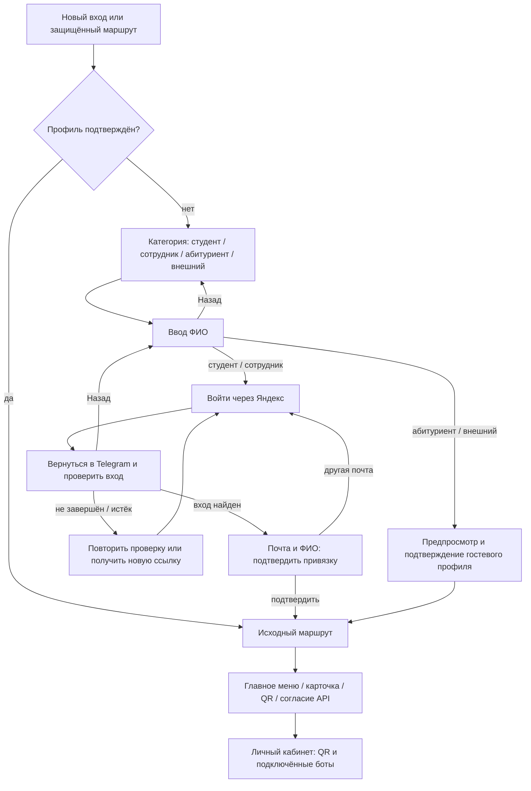
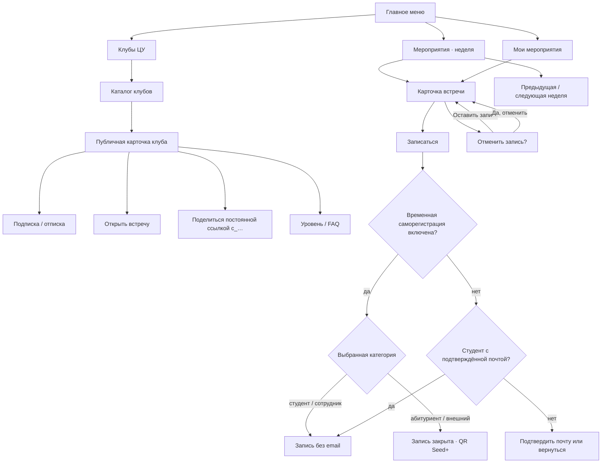
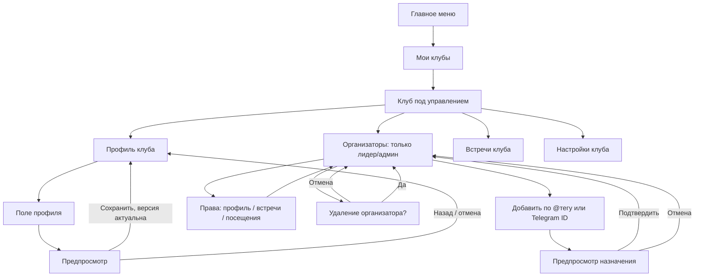
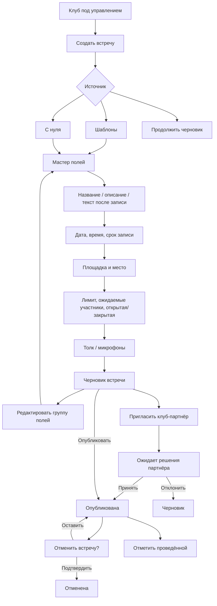
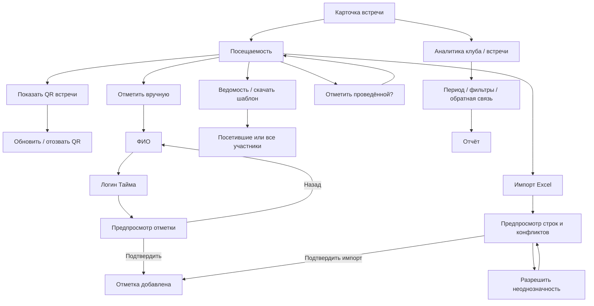
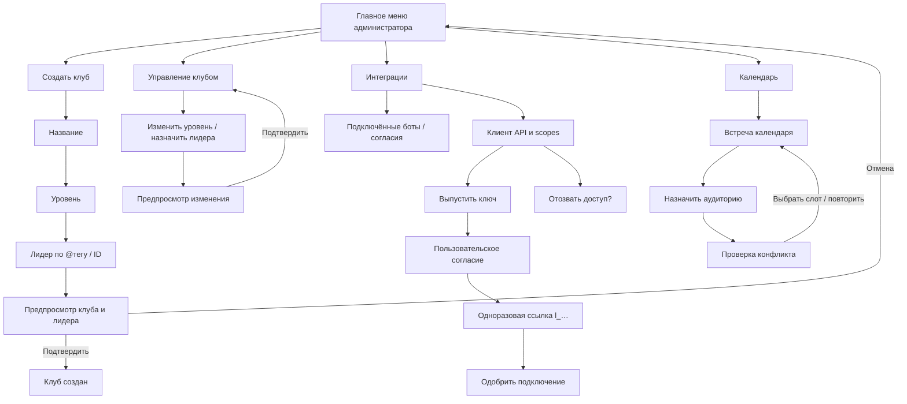

# Карта пользовательских маршрутов

**Сверка для передачи команде: 22 ноября 2026.** Это карта реализованных
маршрутов, не протокол ручной приёмки. Действующий `@cu_clubs_app` остаётся на
прежнем сервере: 65 модулей побайтно совпали с HEAD `b6d4531`, миграция
`20261116_0014`, API/worker/БД healthy. FAQ, календарь, редактирование клуба,
дайджест и остальные маршруты ниже установлены; live UX принят не целиком.
Self-service не переключён, внешняя доступность лидерского API не подтверждена.
Точный статус и открытые сценарии — [project-status.md](project-status.md).

Текущие маршруты:

- Календарь → неделя/фильтр по клубам → карточка → ICS → та же карточка → тот же список.
- Мои мероприятия → предстоящие/история → карточка → тот же раздел и страница.
- Полный FAQ или контекстный раздел → вопрос → список этого раздела → исходный экран;
  ссылка на актуальный справочник остаётся на каждом шаге.
- Профиль клуба → «Изменить несколько полей» → ввод → общий предпросмотр →
  «Изменить ещё»/сохранить. Назад сохраняет ввод, конфликт версии требует нового согласия.
- Админ → дайджест → неделя/выбор → предпросмотр → **текст поста** (страницы/полныйHTML)
  или **карточки: файл для Figma**. Оба выхода используют один проверяемый snapshot.
- Вход через Яндекс (включён на действующем тестовом экземпляре): категория → ФИО → Яндекс → «Проверить вход» →
  почта/ФИО → привязка числовым Telegram ID → исходный маршрут.
  [Настройка и границы проверки](yandex-login.md).
- Каждый экран получает одну из 24 активных иллюстраций; фотографии клубов/QR
  сохраняются. [Карта изображений](media.md).

## Статусы

- **В коде** — экран/переход реализован в текущей ветке.
- **Выпущено в тест** — функция включена в @cu_clubs_app; полная ручная приёмка отдельно.
- **Частично** — часть маршрута работает, но связанные шаги/интеграция/ручная приёмка отсутствуют.
- **Отложено** — продуктовый сценарий описан, но работающего маршрута нет.

Диалоги Telegram хранят состояние в PostgreSQL. Потоки с изменением данных используют отдельный экран предпросмотра и подтверждения, где это предусмотрено логикой. Кнопки «Назад» возвращают к указанной родительской карточке; «Отмена» сбрасывает черновой диалог или возвращает в контекст согласно обработчику. Устаревшие подтверждения проверяются по nonce/версии, а незавершённый ввод сохраняется.

## Участник: вход, категории и профиль

Приоритет режима задаётся настройками: Яндекс включён и обрабатывает вход
раньше временной саморегистрации. Флаги саморегистрации и непроверенных лидеров
в тестовой среде остаются включены; они не подтверждают почту. Строгий допуск
к предварительной записи при Яндексе требует `verified_at` и логина профиля.

Исходный безопасный маршрут сохраняется: клуб `c_…`, встреча `e_…`, QR `a_…`,
согласие API `l_…`, профиль, каталог и списки встреч. Привязка требует явного
подтверждения в Telegram: браузерный callback сам профиль не подтверждает.
«Назад» со ссылки возвращает к ФИО, сохраняя ввод и отменяя текущую попытку;
новая ссылка заменяет challenge. Чужой/старый `ya:*` nonce отклоняется.
После такой ошибки «В меню» открывает актуальный выбор; исправление обычной
навигации не ослабляет проверку кнопок подтверждения.

Ручной сквозной вход владельца университетским аккаунтом, возврат к исходному
маршруту и отрицательные сценарии ещё ожидают приёмки. [Вход](yandex-login.md).

**Отдельные прежние режимы в коде.** Если Яндекс выключен и активен test-флаг
саморегистрации: категория → ФИО → логин для студента/сотрудника → предпросмотр →
временный профиль без `verified_at`; гость вводит ФИО без логина. Если оба режима
выключены, `identity_ui.py` поддерживает письмо с кодом; его реальная доставка
зависит от SMTP. Эти пути не являются инструкцией входа действующего экземпляра.

## Участник: каталог, клубы и встречи

Прямые ссылки `/start c_{public_id}` и `/start e_{token}` открывают карточки клуба и встречи. Legacy-блок карточки сохраняется; направление дополняет поля публичной карточки, а ближайшие три открытые будущие встречи идут отдельным блоком. Публичная ссылка на клуб и подписка реализованы. В текущей ветке подключён блок встреч и кнопки перехода (`cevent`). В диалоге сохраняется `club_origin`; карточка встречи возвращает к клубу, если клуб входит в эту встречу. Расширение **реализовано**, ручной приёмочный прогон после записи/отмены и проверка возврата не подтверждены.

Список встреч доступен по неделям, карточка показывает состояние и действие по правам пользователя. При выключенном временном флаге запись доступна подтверждённому студенту; новые студенты и сотрудники подтверждают университетскую почту через включённый Яндекс OAuth. SMTP для текущего входа не требуется. Только в тестовом временном режиме выбранные категории «Студент» и «Сотрудник» могут записываться без email. Категория «Абитуриент» и внешние гости предварительно записаться не могут: им доступна отметка по QR встречи клуба Seed или выше. QR встречного организатора спросит, студент ли пользователь; кнопка «Внешний гость» открывает ввод ФИО и подтверждение отметки. Отмена записи требует подтверждения с возможностью сохранить запись.

## Организатор: управление клубом

Публичная команда на карточке и реальные права участников команды независимы. Лидер/администратор назначает организатора из уже открывавших бота, переключает три права и может удалить его с подтверждением. Редактор профиля сохраняет версии и показывает предпросмотр; направление включено в редактор тестового выпуска. В карточке управления пункты встреч и посещаемости показаны только при наличии соответствующего права. Администратор отдельно управляет уровнем и лидером клуба.

## Организатор: создание, публикация и управление встречей

Мастер хранит значения между полями. Для даты и времени есть отдельный календарный мастер; назад возвращает к предыдущему шагу, ошибки сохраняют введённые данные. Шаблон можно выбрать, создать из встречи, редактировать группами, переименовать или удалить с подтверждением; из шаблона создаётся черновик, который затем можно изменить. Для совместной встречи приглашённый клуб принимает/отклоняет предложение. Публикация и отмена проверяют версии; отмена показывает число записанных и явно подтверждается.

## Организатор: отметки, ведомость и аналитика

QR встречи ведёт к самостоятельной отметке участника: для подходящего студента/гостя подтверждение, для гостя без профиля — ФИО и предпросмотр регистрации плюс отметка. Личный QR посетителя при сканировании организатором предлагает выбрать доступную встречу и подтвердить отметку. Ручной ввод организатора требует подтверждения. Импорт сначала показывает строки и требует разрешить неоднозначности; повторное открытие предпросмотра сохраняет контекст, финальная кнопка подтверждает пакет. XLSX-экспорт предлагает ведомость посетивших или всех участников; отдельная кнопка скачивает пустой шаблон. «Проведена» подтверждается отдельно и доступна лидеру/админу.

Уведомления по встрече: выбрать «записавшимся» или «посетившим» → ввести текст → предпросмотр количества получателей → подтвердить постановку в очередь. Отмена возвращает к настройке уведомлений. Экран статуса показывает очереди; повторяются только явные ошибки, неопределённый результат сам не отправляется повторно. Этот новый маршрут **реализовано**.

## Администратор, интеграции и календарь

Администратор создаёт клуб, назначает уровень и уже известного боту лидера; до сохранения видит предпросмотр. Тот же путь версии/предпросмотра используется для смены уровня и лидера. Настройки клуба ведут к опросу клуба и интеграциям. Выдача API-доступа ограничивает scopes, показывает экран согласия пользователя, использует одноразовую ссылку, допускает явное одобрение и отзыв. Текущая интеграция API доступна на сервере/через SSH-туннель; публичный адрес и приёмка реального внешнего бота не подтверждены.

Календарь администратора позволяет просматривать события, выбирать аудиторию, разрешать конфликт или повторять действие. Двусторонний адаптер Sheets и дайджест реализованы и установлены. Sync/write включены только для тестовой копии; актуальность Google-доступа и сквозной сценарий изменения аудитории с сохранением оформления ещё требуют живой приёмки.

## Справка, ограничения и источники

- Полный и контекстный FAQ реализованы и установлены; источник хендбука
  последний раз сверен 16 ноября, а не 22 ноября. Детали и граница Yandex-текста —
  [faq.md](faq.md). Проверки источника не означают ручную приёмку всех переходов.
- Текущий путь почты — включённый Яндекс OAuth; SMTP относится к прежнему режиму.
- Лидерский API реализован, но публичный внешний адрес/сквозной клиент не приняты.
  Polling работает на прежнем сервере; self-service ещё не переключён.
- Google sync/write включены для тестовой копии. Внешняя авторизация и полный
  двусторонний сценарий требуют живой проверки; файл credentials этого не доказывает.
- Есть недельный пользовательский календарь, Sheets-метки и админский дайджест
  с двумя выходами. Публикация в канал и обновление Figma требуют отдельного действия.
- После доставленного backup первый показ/перелистывание переносит окно ниже
  копии и сохраняет её. Старое окно удаляется или по возможности лишается клавиатуры.
  Проверить после реальной копии ещё предстоит. [Медиа и окно](media.md).
- Изображения и тексты совпадающих карточек управляются compatibility-слоем.

Кодовые точки: `telegram.py`, `category_ui.py`, `yandex_ui.py`, `identity_ui.py`,
`event_ui.py`, `event_schedule_ui.py`, `calendar_user_ui.py`, `club_edit_ui.py`,
`template_ui.py`, `attendance_ui.py`, `survey_ui.py`, `analytics_ui.py`,
`notifications_ui.py`, `api_ui.py`, `calendar_ui.py`, `faq_ui.py`, `screens.py`.
Машинный [`ux-map.json`](ux-map.json) — дополнительный индекс, не самостоятельное
доказательство актуальности или живой приёмки. Точные legacy-границы —
[`legacy-compatibility.md`](legacy-compatibility.md).

## Админский дайджест: текущие выходы

Админ-меню → Создать дайджест → неделя → все открытые встречи / ручной выбор
по 8 встреч с сохранёнными галочками → предпросмотр → текст поста или JSON для Figma.
Доступ проверяется на каждом действии. При изменении встреч обновляется
предпросмотр, файл не выдаётся молча. Лимиты и ошибки сохраняют контекст.

В Figma: выделить обложку и страницы одной недели → загрузить файл → проверить →
создать копию. Плагин заменяет оранжевые строки и точки, сохраняет остальные
категории и перераскладывает страницы; выбранную секцию плагина можно обновить.
Шрифт/переполнение проверяются, исходные страницы не изменяются. Этот маршрут
отдельный от существующего недельного пользовательского списка и Sheets-меток.

[Инструкция экспорта](digest-export.md) · [Плагин](../figma/digest/README.md).
