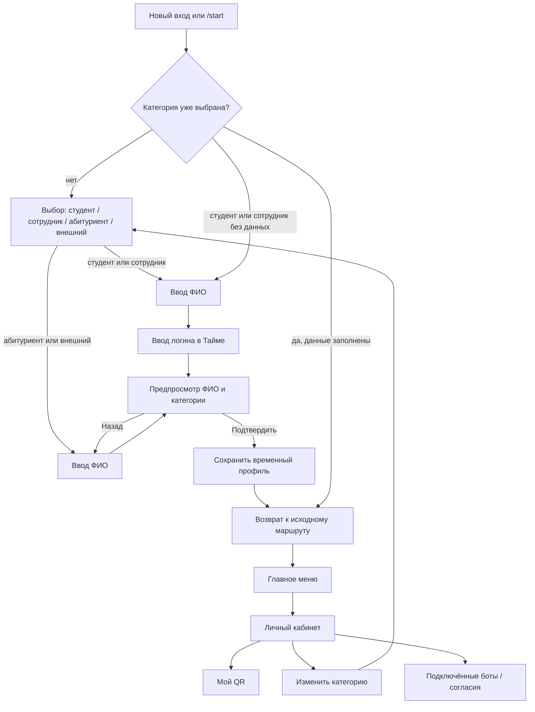
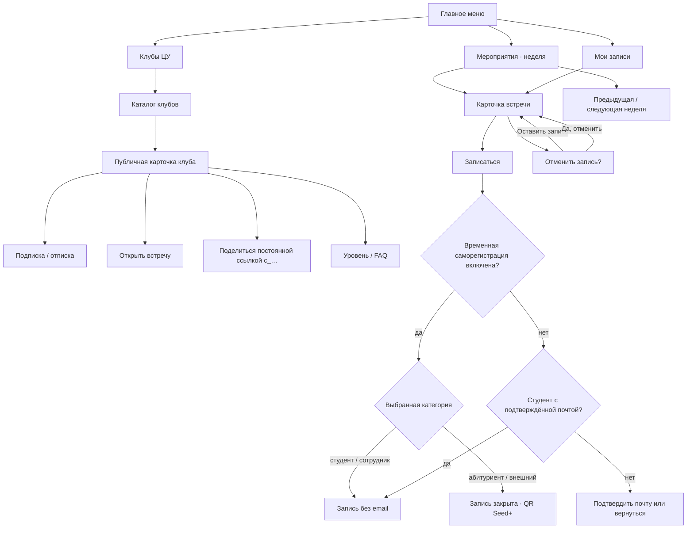
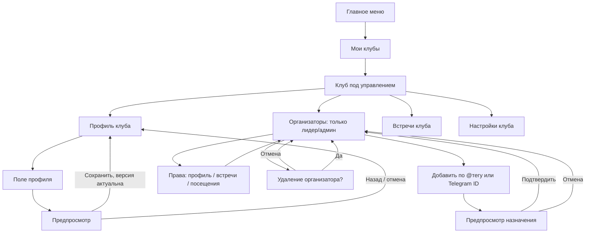
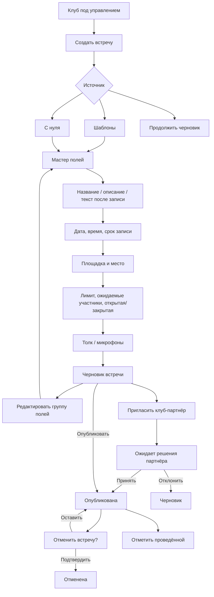
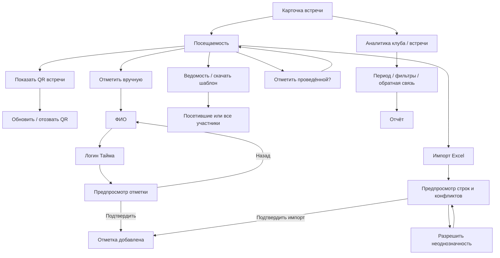
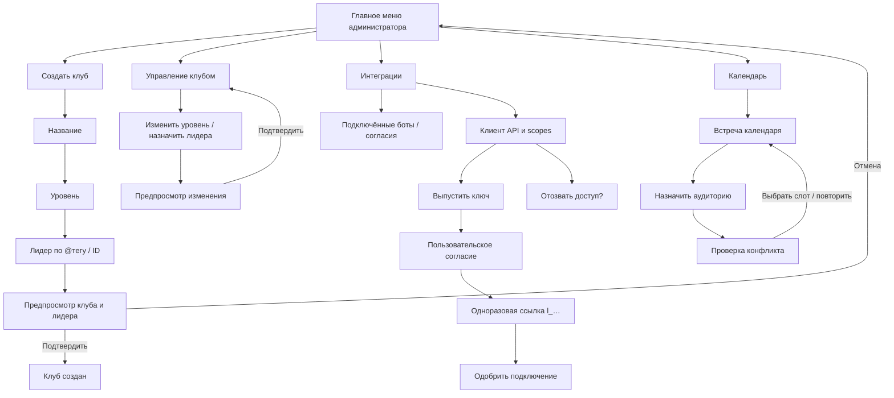

# Карта пользовательских маршрутов

Снимок исходников на 15 ноября 2026. Это карта экранов и переходов, собранных в коде, а не протокол ручного прогона Telegram. Категории, уведомления и карточки включены в выпуск c176a0d; обязательные ФИО/логин и исправление занятого логина выложены пакетом 27c47c5 тестового @cu_clubs_app. Установленная версия и схема проверены; карта остаётся описанием кода, а не протоколом ручного нажатия каждой кнопки. Публичная HTTPS-приёмка и ручное прохождение полного набора кнопок не подтверждены.

## Статусы

- **В коде** — экран/переход реализован в текущей ветке.
- **Выпущено в тест** — функция включена в @cu_clubs_app; полная ручная приёмка отдельно.
- **Частично** — часть маршрута работает, но связанные шаги/интеграция/ручная приёмка отсутствуют.
- **Отложено** — продуктовый сценарий описан, но работающего маршрута нет.

Диалоги Telegram хранят состояние в PostgreSQL. Потоки с изменением данных используют отдельный экран предпросмотра и подтверждения, где это предусмотрено логикой. Кнопки «Назад» возвращают к указанной родительской карточке; «Отмена» сбрасывает черновой диалог или возвращает в контекст согласно обработчику. Устаревшие подтверждения проверяются по nonce/версии, а незавершённый ввод сохраняется.

## Участник: вход, категории и профиль

Временный выбор категории не подтверждает университетскую почту. Он разрешён только при активном флаге саморегистрации (сейчас он доступен в тестовом контексте); гейт сохраняет безопасный исходный маршрут и возвращает пользователя после выбора. Поддержаны клуб (`c_…`), встреча (`e_…`), QR (`a_…`), согласие API (`l_…`), личный кабинет, каталог, список встреч и «Мои записи». Категории «Абитуриент» и «Внешний» без существующего профиля запрашивают ФИО с отдельным предпросмотром. Самовыбор включён в тестовом выпуске c176a0d.

Обычный маршрут студенческой верификации: ФИО → логин Тайма → предпросмотр → письмо с одноразовым кодом → ввод кода/повтор отправки → возврат в исходную встречу или QR. Реальная доставка писем недоступна до настройки SMTP, поэтому это **частично**. Тестовый обход не означает подтверждённую почту.

## Участник: каталог, клубы и встречи

Прямые ссылки `/start c_{public_id}` и `/start e_{token}` открывают карточки клуба и встречи. Legacy-блок карточки сохраняется; направление дополняет поля публичной карточки, а ближайшие три открытые будущие встречи идут отдельным блоком. Публичная ссылка на клуб и подписка реализованы. В текущей ветке подключён блок встреч и кнопки перехода (`cevent`). В диалоге сохраняется `club_origin`; карточка встречи возвращает к клубу, если клуб входит в эту встречу. Расширение **реализовано**, ручной приёмочный прогон после записи/отмены и проверка возврата не подтверждены.

Список встреч доступен по неделям, карточка показывает состояние и действие по правам пользователя. При выключенном временном флаге запись доступна подтверждённому студенту; у новых студентов путь зависит от почтовой верификации, ожидающей SMTP. Только в тестовом временном режиме выбранные категории «Студент» и «Сотрудник» могут записываться без email. Категория «Абитуриент» и внешние гости предварительно записаться не могут: им доступна отметка по QR встречи клуба Seed или выше. QR встречного организатора спросит, студент ли пользователь; кнопка «Внешний гость» открывает ввод ФИО и подтверждение отметки. Отмена записи требует подтверждения с возможностью сохранить запись.

## Организатор: управление клубом

Публичная команда на карточке и реальные права участников команды независимы. Лидер/администратор назначает организатора из уже открывавших бота, переключает три права и может удалить его с подтверждением. Редактор профиля сохраняет версии и показывает предпросмотр; направление включено в редактор тестового выпуска. В карточке управления пункты встреч и посещаемости показаны только при наличии соответствующего права. Администратор отдельно управляет уровнем и лидером клуба.

## Организатор: создание, публикация и управление встречей

Мастер хранит значения между полями. Для даты и времени есть отдельный календарный мастер; назад возвращает к предыдущему шагу, ошибки сохраняют введённые данные. Шаблон можно выбрать, создать из встречи, редактировать группами, переименовать или удалить с подтверждением; из шаблона создаётся черновик, который затем можно изменить. Для совместной встречи приглашённый клуб принимает/отклоняет предложение. Публикация и отмена проверяют версии; отмена показывает число записанных и явно подтверждается.

## Организатор: отметки, ведомость и аналитика

QR встречи ведёт к самостоятельной отметке участника: для подходящего студента/гостя подтверждение, для гостя без профиля — ФИО и предпросмотр регистрации плюс отметка. Личный QR организатора предлагает выбрать активную встречу и подтвердить отметку. Ручной ввод организатора требует подтверждения. Импорт сначала показывает строки и требует разрешить неоднозначности; повторное открытие предпросмотра сохраняет контекст, финальная кнопка подтверждает пакет. XLSX-экспорт предлагает ведомость посетивших или всех участников; отдельная кнопка скачивает пустой шаблон. «Проведена» подтверждается отдельно и доступна лидеру/админу.

Уведомления по встрече: выбрать «записавшимся» или «посетившим» → ввести текст → предпросмотр количества получателей → подтвердить постановку в очередь. Отмена возвращает к настройке уведомлений. Экран статуса показывает очереди; повторяются только явные ошибки, неопределённый результат сам не отправляется повторно. Этот новый маршрут **реализовано**.

## Администратор, интеграции и календарь

Администратор создаёт клуб, назначает уровень и уже известного боту лидера; до сохранения видит предпросмотр. Тот же путь версии/предпросмотра используется для смены уровня и лидера. Настройки клуба ведут к опросу клуба и интеграциям. Выдача API-доступа ограничивает scopes, показывает экран согласия пользователя, использует одноразовую ссылку, допускает явное одобрение и отзыв. Текущая интеграция API работает на сервере/через SSH-туннель; публичный HTTPS и приёмка реального внешнего бота впереди.

Календарь администратора позволяет просматривать события, выбирать аудиторию, разрешать конфликт или повторять действие. Двусторонняя синхронизация/дайджест остаются отложенными; текущий интерфейс календаря не означает готовность всего планируемого процесса.

## Справка, ограничения и источники

- FAQ имеет частичные тексты «Как пользоваться ботом» и «Уровни клубов»; остальные разделы справочника и переходы из FAQ неполны (**частично**).
- Настоящее подтверждение почты ожидает настройки SMTP (**частично**).
- Публичный HTTPS, внешний production API, календарный дайджест и перенос git/хостинга в cu3rd не реализованы/не приняты (**отложено**). Polling работает; миграция на webhook — будущий шаг после HTTPS.
- Рассылки анонсов подписчикам клуба и личные напоминания не следует считать тем же экраном, что ручные уведомления встречи; автоматические анонсы открытых встреч работают; большой процесс дайджеста отложен.
- Изображения и legacy-тексты карточек остаются управляемыми существующим compatibility-слоем.

Кодовые точки: `telegram.py` (вход, меню, каталог и профиль клуба), `category_ui.py`, `identity_ui.py`, `event_ui.py`, `event_schedule_ui.py`, `template_ui.py`, `attendance_ui.py`, `survey_ui.py`, `analytics_ui.py`, `notifications_ui.py`, `api_ui.py`, `calendar_ui.py`. Дополнительный перечень маршрутов для explorer: [`ux-map.json`](ux-map.json). Общее состояние релиза: [`project-status.md`](project-status.md); UX-ограничения каталога и профиля: [`legacy-compatibility.md`](legacy-compatibility.md).

Обновление исходников после выпуска c176a0d: студент и сотрудник обязательно проходят ФИО → логин в Тайме → предпросмотр → подтверждение. Оба поля сохраняются и отображаются в личном кабинете; `verified_at` не меняется. Незаполненный ранее выбранный университетский профиль снова проходит ввод, а общие сервисы не дают ему записаться до заполнения. Назад из предпросмотра возвращает к логину, далее к ФИО и выбору категории; поля сохраняются при возврате. Проверено 33 целевыми тестами на временном PostgreSQL; это не утверждение о выкладке этого дополнения.
